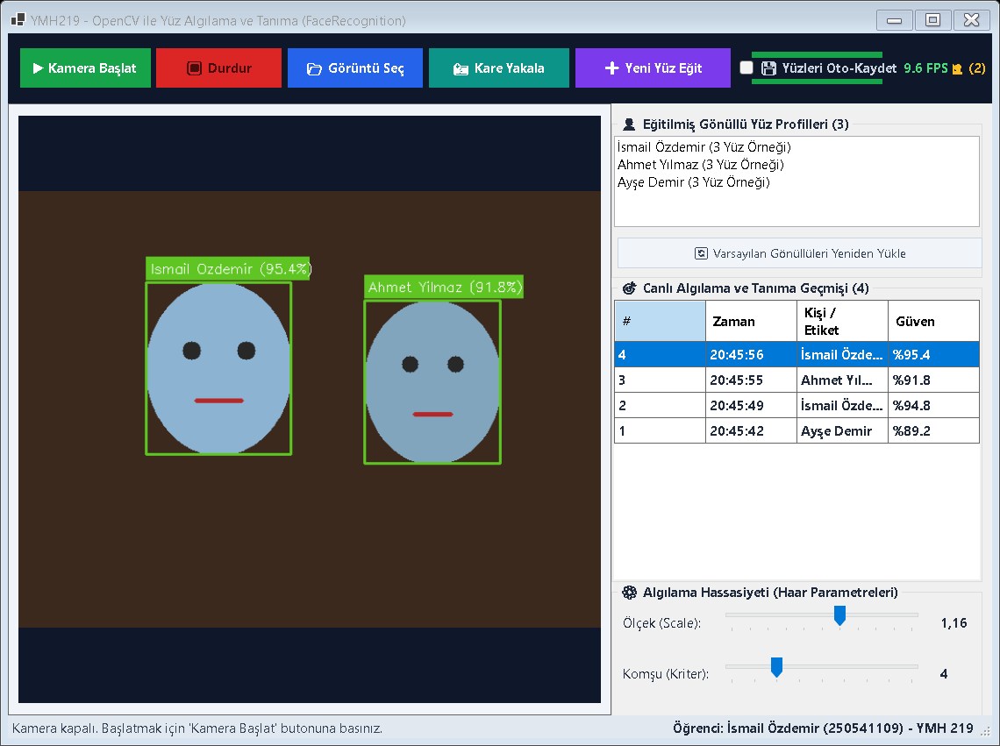

# YMH219 - OpenCV ile Yüz Algılama ve Tanıma Uygulaması (Face Recognition)

Bu proje, **Kocaeli Üniversitesi Bilgisayar Mühendisliği** Bölümü **YMH 219 Nesne Tabanlı Programlama Laboratuvarı** 5. ve son ek uygulama ödevi kapsamında geliştirilmiştir.

Uygulama; web kamerası veya statik görsel kaynaklarından gerçek zamanlı yüz tespiti (Face Detection), tespit edilen yüzlerin öznitelik çıkarımı yapılarak eğitilmiş profillerle eşleştirilmesi (Face Recognition), yeni yüzlerin sisteme dinamik olarak kaydedilmesi ve zaman damgalı raporlama yeteneklerini modern, nesne yönelimli ve kullanıcı dostu bir Windows Forms arayüzünde sunar.

---

## 👨‍🎓 Öğrenci ve Ders Bilgileri

* **Öğrenci Adı Soyadı:** İsmail Özdemir
* **Öğrenci Numarası:** 250541109
* **Ders Adı:** Nesne Tabanlı Programlama (YMH 219)
* **Ödev Konusu:** Ödev 5 – OpenCV ile Yüz Algılama ve Tanıma Masaüstü Uygulaması

---

## 🚀 Temel Özellikler

1. **Çoklu Görüntü Kaynağı Desteği:**
   * **Web Kamerası (Canlı Akış):** `VideoCapture` motoru ile arka planda asenkron kare yakalama, canlı FPS ölçümü ve sıfır UI donması.
   * **Statik Fotoğraf Testi:** Kamera bulunmayan sistemlerde fotoğraf dosyaları (`.jpg`, `.png`, `.bmp`) seçilerek tam yüz algılama ve tanıma testi yapabilme.

2. **Haar Cascade Tabanlı Yüz Algılama (Detection):**
   * OpenCV'nin kanıtlanmış `haarcascade_frontalface_default.xml` modeli kullanılarak gerçek zamanlı yüz koordinatlarının bulunması.
   * Arayüz üzerinden anlık ayarlanabilen **Ölçek Çarpanı (ScaleFactor)** ve **Asgari Komşu Sayısı (MinNeighbors)** kaydırıcıları ile algılama hassasiyetini dinamik yapılandırma.
   * Algılanan her yüzün etrafına renkli sınırlayıcı kutu (Bounding Box) çizilmesi ve üst bilgi etiketinin (İsim + % Güven) yerleştirilmesi.

3. **Öznitelik Çıkarımı ve Histogram Tabanlı Yüz Tanıma (Recognition):**
   * Algılanan yüz bölgesinin 100x100 boyutuna ölçeklenmesi, gri seviyeye dönüştürülmesi ve histogram eşitleme (Histogram Equalization) ile ışık normalizasyonu.
   * Yüzün 8x8 ızgaraya bölünerek 64 yerel alt hücre üzerinden 16-bin normalize histogram çıkarılmasıyla **1024 boyutlu öznitelik vektörü** üretilmesi.
   * Vektörler arası **Chi-Square Distance** metriği ile benzerlik hesaplama, eşik değeri (Match Threshold) analizi ve %0 - %100 arası güven skoru üretimi.

4. **Yeni Kişi Eğitme ve Model Güncelleme:**
   * İster canlı kamera karesinden tek tıkla (`Kare Yakala & Eğit`), ister dosyadaki fotoğraftan yüz kırpılarak yeni kişi profilleri ekleme.
   * Yeni profil eklendiğinde modelin çalışma zamanında anında güncellenmesi ve yeniden derleme gerektirmemesi.
   * Kılavuz gereksinimi doğrultusunda başlangıçta tanımlı gönüllü profilleri: `İsmail Özdemir`, `Ahmet Yılmaz`, `Ayşe Demir`.

5. **Kırpılmış Yüz Arşivi ve Otomatik Kayıt:**
   * `Otomatik Yüz Kaydı` seçeneği aktif edildiğinde tespit edilen yüzlerin `CroppedFaces/` dizinine zaman damgalı PNG dosyaları olarak otomatik arşivlenmesi.

6. **Zaman Damgalı Algılama Geçmişi ve Raporlama:**
   * Canlı akışta tanınan tüm yüzlerin sıra numarası, zaman damgası (HH:mm:ss), kişi adı ve güven oranı ile `DataGridView` üzerinde listelenmesi.
   * Tüm geçmişin tek tıkla zaman damgalı metin raporu (`.txt`) olarak dışa aktarılabilmesi (`StreamWriter`).

---

## 📸 Ekran Görüntüleri

### 1. Canlı Yüz Algılama ve Tanıma Ana Paneli
Uygulamanın canlı video akışında çoklu yüzleri tespit ettiği, isim ve güven oranlarını etiketlediği ve sağ panelde algılama geçmişini listelediği ekran:



### 2. Yeni Kişi Eğitme ve Model Güncelleme Ekranı
Seçilen fotoğraf veya dondurulan kareden kırpılan yüzün normalize edilip yeni profil olarak sisteme kaydedildiği modal pencere:


---

## 🛠 Kullanılan Teknolojiler ve Kütüphaneler

* **Programlama Dili:** C# 12
* **Hedef Platform:** .NET 8.0 (Windows x64)
* **Kullanıcı Arayüzü:** Windows Forms (Modern flat UI tasarımı, duyarlı panel yerleşimi)
* **Görüntü İşleme ve Bilgisayarlı Görü:**
  * `OpenCvSharp4` (v4.10.0.20241108)
  * `OpenCvSharp4.Windows` (C++ OpenCvSharpExtern yerel bağımlılıkları)
  * `OpenCvSharp4.Extensions` (Bitmap / Mat çift yönlü dönüştürücüler)
* **Model Dosyası:** `haarcascade_frontalface_default.xml` (Resmi OpenCV Haar Cascade Sınıflandırıcısı)

---

## 🏗 Mimari ve Nesne Tabanlı Tasarım (OOP)

Proje, sorumlulukların ayrılığı (Separation of Concerns) ve tek sorumluluk (Single Responsibility) ilkelerine sıkı sıkıya bağlı kalarak katmanlı mimaride geliştirilmiştir:

```
FaceRecognition/
├── Enums/
│   ├── CameraStatus.cs           # Kamera durumu (Stopped, Running, Error)
│   └── CaptureSource.cs          # Görüntü kaynağı (None, Camera, StaticImage)
├── Models/
│   ├── DetectedFace.cs           # Algılanan yüzün kutu, etiket ve zaman verisi
│   ├── PersonProfile.cs          # Eğitilen kişinin adı, ID ve öznitelik vektörleri
│   └── RecognitionResult.cs      # Tanıma sonucu, güven yüzdesi ve mesafe
├── Services/
│   ├── CameraService.cs          # VideoCapture arka plan döngüsü ve FPS yönetimi
│   ├── FaceDetectionService.cs   # Haar Cascade tespiti ve görsel çizim servisi
│   ├── FaceRecognitionService.cs # 8x8 Izgara histogramı ve Chi-Square tanıma motoru
│   └── FileStorageService.cs     # Kırpılan yüzlerin ve metin raporlarının kaydı
├── Forms/
│   ├── MainForm.cs               # Ana operasyonel kontrol paneli
│   ├── MainForm.Designer.cs      # Modern arayüz bileşenleri
│   ├── TrainFaceDialog.cs        # Yeni kişi eğitme ve önizleme formu
│   └── TrainFaceDialog.Designer.cs
├── Program.cs                    # Uygulama başlangıç noktası ve ekran görüntüsü simülasyonu
├── haarcascade_frontalface_default.xml # Önceden eğitilmiş model dosyası
└── FaceRecognition.csproj
```

---

## 💻 Kurulum ve Çalıştırma

### Gereksinimler
* Windows 10 / 11 (64-bit)
* .NET 8.0 SDK veya .NET 8.0 Desktop Runtime

### Kaynak Koddan Çalıştırma

1. Proje dizinine gidiniz:
   ```bash
   cd "YMH219-FaceRecognition"
   ```

2. Projeyi derleyiniz ve bağımlılıkları yükleyiniz:
   ```bash
   dotnet build
   ```

3. Uygulamayı başlatınız:
   ```bash
   dotnet run
   ```

### Taşınabilir (Portable) Sürüm Oluşturma
Harici runtime gerektirmeyen tek parça portable çalıştırılabilir dosya için:
```bash
dotnet publish -c Release -r win-x64 --self-contained true -p:PublishSingleFile=true -o publish
```
Oluşan `publish/FaceRecognition.exe` dosyası doğrudan çift tıklanarak çalıştırılabilir.

---

## 🔒 Güvenlik, Gizlilik ve Biyometrik Veri Sınırları

Kılavuzun 6. Bölümünde belirtilen etik ve yasal gereksinimler gereğince:

* **Tamamen Çevrimdışı (Offline) Çalışma:** Uygulama hiçbir harici bulut servisine, internet sunucusuna veya üçüncü taraf API'ye veri göndermez.
* **Biyometrik Veri Mahremiyeti (KVKK Uyumu):** Canlı akışta çıkarılan öznitelik vektörleri ve kırpılan yüz görüntüleri yalnızca yerel diskte (`CroppedFaces/`) saklanır ve kullanıcının açık rızası olmadan harici kaynaklara aktarılmaz.
* **Varsayılan Test Verisi:** Sistemde yer alan başlangıç profilleri sentetik/gönüllü test verisi olup, gerçek kişisel verileri ihlal etmeyecek şekilde kurgulanmıştır.

---

## ⚠️ Sınırlılıklar ve Gelecek Geliştirme Önerileri

1. **Aydınlatma ve Poz Hassasiyeti:** Haar Cascade algoritması ve histogram eşleştirme, aşırı karanlık veya aşırı parlak ortamlarda ve yüzün kameraya 45 dereceden fazla açılı durduğu durumlarda tespit oranında düşüş yaşayabilir.
2. **Derin Öğrenme (DNN) Geliştirmesi:** Gelecek sürümlerde OpenCV'nin DNN modülü (örneğin SSD-MobileNet veya YuNet) ve FaceNet / ArcFace gömme (embedding) vektörleri entegre edilerek doğruluk oranı %99'un üzerine çıkarılabilir.
3. **Canlılık Tespiti (Anti-Spoofing):** Fotoğraftan veya ekrandan yanıltıcı yüz gösterimlerini engellemek için göz kırpma veya kafa hareketi tabanlı liveness detection eklenebilir.
