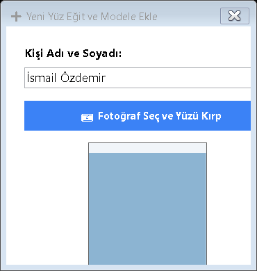

# YMH219 - OpenCV ile Yüz Algılama ve Tanıma Uygulaması (Face Recognition)

Bu proje, **Kocaeli Üniversitesi Bilgisayar Mühendisliği** Bölümü **YMH 219 Nesne Tabanlı Programlama Laboratuvarı** 5. ve son ek uygulama ödevi kapsamında geliştirilmiştir.

Uygulama; web kamerası veya statik görsel kaynaklarından gerçek zamanlı yüz tespiti (Face Detection), tespit edilen yüzlerin öznitelik çıkarımı yapılarak eğitilmiş profillerle eşleştirilmesi (Face Recognition), yeni yüzlerin sisteme dinamik olarak kaydedilmesi, canlılık tespiti (Anti-Spoofing), gülümseme algılama, Türkçe sesli karşılama (TTS) ve güvenlik alarmı yeteneklerini modern, nesne yönelimli ve kullanıcı dostu bir Windows Forms arayüzünde sunar.

---

## 👨‍🎓 Öğrenci ve Ders Bilgileri

* **Öğrenci Adı Soyadı:** İsmail Özdemir
* **Öğrenci Numarası:** 250541109
* **Ders Adı:** Nesne Tabanlı Programlama (YMH 219)
* **Ödev Konusu:** Ödev 5 – OpenCV ile Yüz Algılama ve Tanıma Masaüstü Uygulaması

---

## 🚀 Temel ve İleri Seviye Özellikler

1. **Çoklu Görüntü Kaynağı ve Kamera Yönetimi:**
   * **DirectShow Öncelikli Kamera Motoru:** Windows işletim sisteminde donanım uyumluluğunu en üst düzeye çıkaran `DirectShow (DSHOW)` tabanlı video yakalama ve `Media Foundation (MSMF)` yedeği.
   * **Kamera Seçim Kutusu:** Birden fazla kamera içeren sistemlerde Kamera #0 (Dahili HD Webcam) ve Kamera #1 (Harici USB Kamera) arasında dinamik geçiş.
   * **🎮 Sanal Kamera (Test Simülatörü):** Fiziksel web kamerası bulunmayan veya kamerası başka bir uygulama tarafından meşgul edilen ortamlarda; canlı hareket eden, göz kırpan ve gülümseyen sentetik yüz simülasyonu ile uygulamanın tüm özelliklerini sıfır donanım engeliyle test edebilme.
   * **Statik Fotoğraf Testi:** Dosya yöneticisinden fotoğraf (`.jpg`, `.png`, `.bmp`) seçerek çoklu yüz algılama ve tanıma testi yapabilme.

2. **Haar Cascade Tabanlı Yüz, Göz ve Gülümseme Tespiti:**
   * OpenCV'nin `haarcascade_frontalface_default.xml` modeliyle gerçek zamanlı çoklu yüz koordinatlarının bulunması.
   * Arayüz üzerinden canlı ayarlanabilen **Ölçek Çarpanı (ScaleFactor)** ve **Asgari Komşu Sayısı (MinNeighbors)** kaydırıcıları ile algılama hassasiyetini dinamik yapılandırma.
   * Algılanan her yüzün etrafına renkli sınırlayıcı kutu (Bounding Box) çizilmesi ve üst bilgi etiketinin (İsim + % Güven) yerleştirilmesi.

3. **Öznitelik Çıkarımı ve Histogram Tabanlı Yüz Tanıma:**
   * Algılanan yüz bölgesinin 100x100 boyutuna ölçeklenmesi, gri seviyeye dönüştürülmesi ve histogram eşitleme (Histogram Equalization) ile ışık normalizasyonu.
   * Yüzün 8x8 ızgaraya bölünerek 64 yerel alt hücre üzerinden 16-bin normalize histogram çıkarılmasıyla **1024 boyutlu öznitelik vektörü** üretilmesi.
   * Vektörler arası **Chi-Square Distance** metriği ile benzerlik hesaplama, eşik değeri (Match Threshold) analizi ve %0 - %100 arası güven skoru üretimi.

4. **🛡️ Canlılık Tespiti ve Sahtecilik Önleme (Liveness / Anti-Spoofing):**
   * `haarcascade_eye.xml` modeli kullanılarak yüz bölgesindeki açık gözler ve kırpma hareketleri taranır.
   * Ekrana tutulan cansız fotoğraf ile gerçek canlı insan arasındaki fark analiz edilir; doğrulanmış canlı yüzlerde yeşil `CANLI [OK]` rozeti gösterilir.

5. **😊 Gülümseme ve Mimik Analizi:**
   * `haarcascade_smile.xml` modeli entegrasyonuyla yüzün ağız bölgesindeki tebessüm ve gülümseme mimikleri gerçek zamanlı tespit edilerek görsel `GULUMSEME :)` rozeti eklenir.

6. **🔊 Türkçe Sesli Karşılama ve Güvenlik Anonsu (TTS):**
   * `System.Speech` sentezleyici motoru ile tanınan kişi kameraya girdiğinde adıyla Türkçe sesli karşılama: *"Hoş geldiniz İsmail Bey. Sistem sizi tanıdı."*
   * Bilinmeyen bir kişi algılandığında sesli uyarı: *"Dikkat: Tanımlanamayan kişi algılandı."*
   * Tekrarlayan anons kirliliğini önleyen kişi bazlı akıllı soğuma (cooldown) mekanizması.

7. **🚨 Güvenlik Alarm Modu:**
   * Bilinmeyen bir kişi kameranın karşısında 3 saniyeden uzun süre kaldığında video çerçevesi kırmızı renkle yanıp söner, sesli alarm çalar ve şüpheli anlık kare `Alerts/` klasörüne otomatik arşivlenir.

8. **🌙 Koyu / ☀️ Açık Tema Desteği:**
   * Tek tıkla modern koyu tema (Slate-900 / Dark UI) ile açık tema (Slate-100 / Light UI) arasında kusursuz geçiş.

9. **Yeni Kişi Eğitme ve Model Güncelleme:**
   * Canlı kamera karesinden (`Kareyi Eğit`) veya seçilen fotoğraftan yüz kırpılarak yeni kişi profilleri ekleme ve veri setini anında genişletme.
   * Kılavuz gereksinimi doğrultusunda başlangıçta tanımlı gönüllü profilleri: `İsmail Özdemir`, `Ahmet Yılmaz`, `Ayşe Demir`.

10. **Kırpılmış Yüz Arşivi ve Raporlama:**
    * `Otomatik Yüz Kaydı` seçeneğiyle algılanan yüzlerin `CroppedFaces/` dizinine zaman damgalı PNG olarak kaydedilmesi.
    * Algılama ve tanıma geçmişinin tek tıkla zaman damgalı `.txt` raporu olarak dışa aktarılması (`StreamWriter`).

---

## 📸 Ekran Görüntüleri

### 1. Canlı Yüz Algılama, Canlılık ve Tanıma Ana Paneli
Uygulamanın canlı video akışında çoklu yüzleri tespit ettiği, isim ve güven oranlarını etiketlediği, canlılık ve mimik durumunu rozetlediği ve sağ panelde tüm gelişmiş ayarları sunduğu arayüz:


### 2. Yeni Kişi Eğitme ve Model Güncelleme Ekranı
Seçilen fotoğraf veya dondurulan kareden kırpılan yüzün normalize edilip yeni profil olarak sisteme kaydedildiği modal pencere:



---

## 🛠 Kullanılan Teknolojiler ve Kütüphaneler

* **Programlama Dili:** C# 12
* **Hedef Platform:** .NET 8.0 (Windows x64)
* **Kullanıcı Arayüzü:** Windows Forms (Modern flat UI tasarımı, Dark/Light tema)
* **Görüntü İşleme ve Bilgisayarlı Görü:**
  * `OpenCvSharp4` (v4.13.0)
  * `OpenCvSharp4.Windows` (C++ OpenCvSharpExtern yerel bağımlılıkları)
  * `OpenCvSharp4.Extensions` (Bitmap / Mat çift yönlü dönüştürücüler)
* **Ses Sentezleme:**
  * `System.Speech` (Windows TTS motoru, Türkçe ses sentezleme)
* **Haar Cascade Model Dosyaları:**
  * `haarcascade_frontalface_default.xml` (Yüz Tespiti)
  * `haarcascade_eye.xml` (Göz ve Canlılık Tespiti)
  * `haarcascade_smile.xml` (Gülümseme ve Mimik Tespiti)

---

## 🏗 Mimari ve Nesne Tabanlı Tasarım (OOP)

Proje, sorumlulukların ayrılığı (Separation of Concerns) ve tek sorumluluk (Single Responsibility) ilkelerine sıkı sıkıya bağlı kalarak katmanlı mimaride geliştirilmiştir:

```
FaceRecognition/
├── Enums/
│   ├── CameraStatus.cs           # Kamera durumu (Stopped, Running, Error)
│   └── CaptureSource.cs          # Görüntü kaynağı (None, Camera, StaticImage)
├── Models/
│   ├── DetectedFace.cs           # Algılanan yüzün kutu, etiket, canlılık, mimik ve zaman verisi
│   ├── PersonProfile.cs          # Eğitilen kişinin adı, ID ve öznitelik vektörleri
│   └── RecognitionResult.cs      # Tanıma sonucu, güven yüzdesi ve mesafe
├── Services/
│   ├── CameraService.cs          # DirectShow, MSMF ve Sanal Kamera simülasyonu
│   ├── FaceDetectionService.cs   # Haar Cascade yüz, göz, gülümseme ve etiket çizim servisi
│   ├── FaceRecognitionService.cs # 8x8 Izgara histogramı ve Chi-Square tanıma motoru
│   ├── FileStorageService.cs     # Kırpılan yüzlerin ve metin raporlarının kaydı
│   ├── SecurityAlarmService.cs   # Bilinmeyen kişi güvenlik alarmı ve delil kaydı
│   └── VoiceAnnouncerService.cs  # Türkçe Text-to-Speech sesli karşılama servisi
├── Forms/
│   ├── MainForm.cs               # Ana operasyonel kontrol paneli ve tema yönetimi
│   ├── MainForm.Designer.cs      # Modern arayüz bileşenleri ve kontroller
│   ├── TrainFaceDialog.cs        # Yeni kişi eğitme ve önizleme formu
│   └── TrainFaceDialog.Designer.cs
├── Program.cs                    # Uygulama başlangıç noktası ve ekran görüntüsü simülasyonu
├── haarcascade_frontalface_default.xml # Yüz sınıflandırıcı modeli
├── haarcascade_eye.xml                # Göz ve canlılık sınıflandırıcı modeli
├── haarcascade_smile.xml              # Gülümseme sınıflandırıcı modeli
└── FaceRecognition.csproj
```

---

## 💻 Kurulum ve Çalıştırma

### Gereksinimler
* Windows 10 / 11 (64-bit)
* .NET 8.0 SDK veya .NET 8.0 Desktop Runtime

### Kaynak Koddan Çalıştırma

1. Proje dizinine gidiniz:
   ```bash
   cd "YMH219-FaceRecognition"
   ```

2. Projeyi derleyiniz:
   ```bash
   dotnet build
   ```

3. Uygulamayı başlatınız:
   ```bash
   dotnet run
   ```

### Taşınabilir (Portable) Sürüm Oluşturma
Harici runtime gerektirmeyen tek parça portable çalıştırılabilir dosya için:
```bash
dotnet publish -c Release -r win-x64 --self-contained true -p:PublishSingleFile=true -o publish
```
Oluşan `publish/FaceRecognition.exe` dosyası doğrudan çift tıklanarak çalıştırılabilir.

---

## 🔒 Güvenlik, Gizlilik ve Biyometrik Veri Sınırları

Kılavuzun 6. Bölümünde belirtilen etik ve yasal gereksinimler gereğince:

* **Tamamen Çevrimdışı (Offline) Çalışma:** Uygulama hiçbir harici bulut servisine, internet sunucusuna veya üçüncü taraf API'ye veri göndermez.
* **Biyometrik Veri Mahremiyeti (KVKK Uyumu):** Canlı akışta çıkarılan öznitelik vektörleri ve kırpılan yüz görüntüleri yalnızca yerel diskte (`CroppedFaces/` ve `Alerts/`) saklanır ve kullanıcının açık rızası olmadan harici kaynaklara aktarılmaz.
* **Varsayılan Test Verisi:** Sistemde yer alan başlangıç profilleri sentetik/gönüllü test verisi olup, gerçek kişisel verileri ihlal etmeyecek şekilde kurgulanmıştır.
